# ERD — Clinic Management System

**Version:** 1.0 (Phase-0 repository audit)
**Source:** `database/migrations/*` (the authoritative schema definition)
**Database:** MySQL in production, SQLite in local dev/tests

This document is a human-readable map of the implemented schema. It reflects
the **intended end state**, including the three migrations currently pending in
the dev database:
`2026_09_14_000004_create_roles_and_permissions_tables`,
`2026_09_14_000005_create_security_events_table`,
`2026_09_17_021438_add_finalization_to_clinical_records`.

All FKs are enforced via Laravel migrations (constrained / cascade / nullOnDelete).
`appointments` has a database-level **unique constraint on
`(doctor_id, scheduled_at)`** as the double-booking backstop (PRD §6/§11).

---

## 1. Diagram (core domains)

```mermaid
erDiagram
    branches ||--o{ users : "has staff"
    branches ||--o{ patients : "registers"
    branches ||--o{ appointments : "schedules"
    branches ||--o{ inventory_items : "owns stock"
    branches ||--o{ invoices : "bills"
    branches ||--o{ lab_orders : "runs tests"

    users ||--o{ doctor_schedules : "works"
    users ||--o{ doctor_time_offs : "takes leave"

    patients ||--o{ appointments : "books"
    patients ||--o{ encounters : "attends"
    patients ||--o{ patient_medical_histories : "has history"
    patients ||--o{ medication_reconciliations : "reconciled"
    patients ||--o{ medical_documents : "uploads"
    patients ||--o{ followups : "scheduled"
    patients ||--o{ leads : "may become"
    patients ||--o{ invoices : "owes"

    appointments ||--o{ queue_entries : "checked in"
    appointments ||--o{ encounters : "produces"
    appointments ||--o{ prescriptions : "prescribed"

    encounters ||--o{ vitals : "records"
    encounters ||--o{ diagnoses : "records"
    encounters o|--o{ encounters : "amends via amends_encounter_id"

    prescriptions ||--o{ prescription_items : "lists"
    prescriptions o|--o{ prescriptions : "amends via amends_prescription_id"
    prescriptions ||--o{ dispensings : "dispensed"
    inventory_batches ||--o{ dispensings : "source batch"

    inventory_items ||--o{ inventory_batches : "batched"
    inventory_items ||--o{ inventory_transactions : "ledger"
    inventory_batches ||--o{ inventory_transactions : "ledger per batch"

    suppliers ||--o{ purchases : "supplied"
    purchases ||--o{ purchase_items : "line items"

    invoices ||--o{ invoice_items : "line items"
    invoices ||--o{ payments : "paid by"
    invoices ||--o{ refunds : "reversed by"
    invoices ||--o{ jazzcash_transactions : "gateway attempts"
    payments ||--o{ refunds : "reverses"
    invoices ||--o{ claims : "claimed"
    insurance_providers ||--o{ claims : "pays"

    leads ||--o{ communications : "contacted"
    users ||--o{ communications : "owned"

    lab_orders }o--|| users : "recorded_by / verifier_id"

    users ||--o{ audit_logs : "caused actions"
    users ||--o{ security_events : "triggered"
    users ||--o{ notification_logs : "receives"
    users ||--o{ notification_templates : "created/approved"
    notification_templates ||--o{ notification_logs : "template"
    users ||--o{ ai_content_drafts : "author/reviewer"
```

## 2. Table inventory and columns

### Identity & access (PRD §11 "Core")
| Table | Purpose | Notable columns / constraints |
|---|---|---|
| `branches` | Multi-site clinic/branch model (Phase-0 "clinic model") | `name`, `code`, `address`, `city`, `phone`, `is_active` |
| `users` | Staff + patient logins | `role`, `branch_id`, `is_cross_branch`, `patient_id` (FK), `two_factor_secret`, `two_factor_confirmed_at`, `two_factor_recovery_codes`, `notification_preferences`, `phone` |
| `roles` *(pending)* | RBAC roles | `name` unique, `guard_name` |
| `permissions` *(pending)* | RBAC permissions | `name` unique, `guard_name` |
| `permission_role` *(pending)* | Role→permission pivot | unique `(permission_id, role_id)` |
| `permission_user` *(pending)* | Direct user→permission pivot | unique `(permission_id, user_id)` |
| `role_user` *(pending)* | User→role pivot | unique `(role_id, user_id)` |
| `personal_access_tokens` | Sanctum tokens | `tokenable_*`, `abilities` |
| `sessions` | Session store (SESSION_DRIVER=database) | `user_id`, `last_activity` |
| `doctor_schedules` | Weekly availability | `doctor_id`, `day_of_week`, `start_time`, `end_time`, `is_active` |
| `doctor_time_offs` | Leave blocks | `doctor_id`, `start_date`, `end_date`, soft-deletable |

### Patients (PRD §11 "Clinical")
| Table | Purpose | Notable columns / constraints |
|---|---|---|
| `mrn_sequences` | MRN counter for deterministic MRN generation | `last_value` |
| `patients` | Master patient record | `mrn` (unique), `cnic` (protected, not exposed), `cnic_hash`, `phone_normalized`, `email_normalized`, `branch_id`; duplicate detection keyed off normalized contact fields |
| `patient_medical_histories` | History/allergy entries | `patient_id`, `category`, `allergen_id` (FK), `term`, `reaction`, `severity`, `onset_date`, `is_active` |
| `medication_reconciliations` | Current-medication list shown in the safety panel | `patient_id`, `encounter_id`, `medicine_name`, `dosage`, `frequency`, `source`, `is_active`, `reconciled_by` |
| `medical_documents` | Patient documents (secure storage) | `category`, `file_path`, `mime_type`, `size_bytes`, `branch_id`, soft-deletable |
| `data_export_requests` | GDPR/privacy export queue | `status`, `file_path`, soft-deletable (admin-only policy) |

### Scheduling (PRD §6, §9)
| Table | Purpose | Notable columns / constraints |
|---|---|---|
| `appointments` | Appointment records | `status` ∈ `scheduled/confirmed/checked_in/waiting/in_consultation/completed/cancelled/no-show` (enum-driven); **UNIQUE `(doctor_id, scheduled_at)`** = DB double-booking backstop; `branch_id` |
| `queue_entries` | Arrival / wait-position tracking | `appointment_id`, `patient_id`, `status`, `checked_in_at`, `branch_id` |

### Clinical / EMR (PRD §5, §7, §9)
| Table | Purpose | Notable columns / constraints |
|---|---|---|
| `encounters` | Doctor consultation record | `status` (`draft` default / `finalized` / `voided`), `finalized_at`, `finalized_by`, `voided_at`, `voided_by`, `void_reason`, `amends_encounter_id` (self-FK); index `(patient_id, status)`; soft-deletable; **finalized → amend/void only** |
| `vitals` | Vital signs per encounter | `blood_pressure`, `temperature`, `heart_rate`, `weight`, `recorded_by` |
| `diagnoses` | Encounter diagnosis lines | `icd_code`, `description`, `recorded_by` |
| `prescriptions` | Prescription header | `prescription_number` (unique), `status`, `finalized_at/finalized_by`, `voided_at/voided_by`, `void_reason`, `amends_prescription_id` (self-FK); index `(patient_id, status)` |
| `prescription_items` | Prescription lines | `medicine_name`, `dosage`, `frequency`, `duration`, `instructions`, `quantity` |
| `followups` | Follow-up queue | `patient_id`, `lead_id`, `encounter_id`, `due_at`, `type`, `status`, `assigned_to`, `completed_by`, `branch_id` |
| `clinical_decision_supports` | CDSS alert records | `trigger_type`, `recommendation`, `is_acknowledged` |

### Safety reference data (PRD §7, §12)
| Table | Purpose | Notable columns / constraints |
|---|---|---|
| `allergens` | Allergen master list | `name`, `family`, `aliases` (JSON), `is_approved`, `approved_by`, `approved_at` |
| `drug_interaction_rules` | Drug–drug rule pairs | `medicine_a`, `medicine_b`, `aliases_a/b`, `severity`, `guidance`, `is_approved`, `approved_by/at` |
| `dosage_rules` | Max daily dose rules | `medicine_name`, `aliases`, `max_daily_mg`, `is_approved`, `approved_by/at` |

> **Safety note (PRD §12/§22):** seeded reference rows are placeholders —
> `is_approved = false`. Production must not run with unapproved safety data;
> a named qualified clinical lead must sign off. No code path sets
> `is_approved = true` automatically.

### Laboratory (PRD §9, DESIGN §11)
| Table | Purpose | Notable columns / constraints |
|---|---|---|
| `lab_orders` | Lab workflow status machine | `status` (`ordered/sample_collected/processing/result_entered/awaiting_verification/final`), `recorded_by`, `verifier_id`, `verification_state`, `verified_at`, `result`, `branch_id`. The result is stored as a column on `lab_orders`; there is no separate `lab_results` table (the PRD §11 list names one, but the PRD specifies no multi-result requirement — revisit if panels/multi-analyte results are needed). Sample collection adds `sample_collected_at`, `sample_collected_by`, `sample_identifier` (unique per branch when set). |

### Pharmacy / Inventory (PRD §8, DESIGN §12)
| Table | Purpose | Notable columns / constraints |
|---|---|---|
| `inventory_items` | Medicine / supply / equipment master | `sku` unique, `category`, `unit_price`, `reorder_level`, `branch_id` |
| `inventory_batches` | Purchased batches | `inventory_item_id`, `batch_number`, `expiry_date`, `initial_quantity`, `current_quantity` (derived, not directly edited); soft-deletable |
| `inventory_transactions` | **Authoritative stock ledger** | `inventory_item_id`, `inventory_batch_id`, `quantity`, `type` (stock_in/stock_out/adjustment), `unit_price`, `total_amount`, `reason` |
| `suppliers` | Vendor directory | `name`, `contact_person`, `email`, `phone`, `tax_number`, `branch_id`, soft-deletable |
| `purchases` | Purchase order header | `purchase_number` unique, `status`, `subtotal/tax/total`, `created_by`, `received_by/at`, `branch_id` |
| `purchase_items` | PO line items | `inventory_item_id`, `quantity`, `unit_price`, `batch_number`, `expiry_date` |
| `dispensings` | Dispense records (Stock OUT) | `prescription_id`, `inventory_batch_id`, `quantity_dispensed`, `dispensed_by`; concurrent-safe via transactions/row locking |

### Finance (PRD §10, DESIGN §13)
| Table | Purpose | Notable columns / constraints |
|---|---|---|
| `invoices` | Charged invoices | `invoice_number` unique, `status` (`generated/paid/draft` + finalize state), `subtotal/tax/total`, `amount_paid`, `balance_due`, `branch_id` |
| `invoice_items` | Invoice line items | `description`, `quantity`, `unit_price`, `line_total` |
| `payments` | Full/partial payments | `amount`, `method`, `reference`, `paid_at` |
| `jazzcash_transactions` | JazzCash hosted-checkout attempts | `invoice_id`, `txn_ref_no` unique, `amount`, `status` (`pending/completed/failed/cancelled`), `response_code/message`, `retrieval_reference_no`, `callback_payload` (JSON); only a **HMAC-verified** callback moves it out of `pending`, and a `payments` row is created only from a `completed` one |
| `refunds` | Linked reversals (never rewrite originals) | `invoice_id`, `payment_id`, `amount`, `reason`, `processed_by`; soft-deletable |
| `insurance_providers` | Payer directory | `code`, `name`, `contact_email`, `phone`; soft-deletable |
| `claims` | Insurance claims | `patient_id`, `invoice_id`, `insurance_provider_id`, `policy_number`, `claimed_amount`, `approved_amount`, `status`; soft-deletable |
| `expense_categories` | Expense buckets | `name`, `branch_id`, `is_active`, `sort_order` |
| `expenses` | Clinic expenses | `expense_number`, `amount/tax/total`, `payment_status/method`, `created_by`, `approved_by/at`, `branch_id` |

### CRM / Communications (PRD §4.11, DESIGN §15)
| Table | Purpose | Notable columns / constraints |
|---|---|---|
| `leads` | Lead pipeline | `status` (`new/contacted/qualified/converted/closed_lost` — enum-driven), `service_interest`, `preferred_doctor_id`, `preferred_date/time`, `source`, `assigned_to`, `branch_id`; soft-deletable |
| `communications` | Contact timeline per lead | `channel`, `summary`, `notes`, `occurred_at`, `lead_id`, `user_id` |
| `notification_logs` | WhatsApp/SMS/email/in-app send log | `channel`, `title`, `body`, `status`, `read_at`, `template_id` (FK → `notification_templates`, nullOnDelete) |
| `notification_templates` | Reusable reviewed message templates (PRD §4 module 12, DESIGN §15) | `channel` (`email/sms/whatsapp`), `name`, `subject` (email only), `body`, `is_approved` (default false; **seeder never approves**), `approved_by/at`, `created_by`; `UNIQUE(channel, name)`, `INDEX(channel, is_approved, created_at)`, soft-deletable; approved rows only become sendable via the live approve workflow |

### AI (PRD §4.14, DESIGN §15)
| Table | Purpose | Notable columns / constraints |
|---|---|---|
| `ai_content_drafts` | Non-clinical AI drafts with human approval | `title`, `content_type`, `content`, `status` (`draft/submitted/approved/rejected/published`), `created_by`, `submitted_by/at`, `reviewed_by/at`, `rejection_reason`, `published_at`; **never auto-publishes** |

### System / Audit / Security (PRD §11, §17)
| Table | Purpose | Notable columns / constraints |
|---|---|---|
| `audit_logs` | General action audit trail | `user_id`, `action`, `auditable_type/id`, `old_values`, `new_values`, `ip_address` |
| `security_events` *(pending)* | Security-specific events | `user_id`, `type`, `severity`, `ip_address`, `user_agent`, `payload` (JSON) |
| `system_settings` | Key/value settings | `key`, `value`, `type` (admin-only policy) |
| `system_backups` | Backup records | `filename`, `file_path`, `file_size`, `status`, `generated_by`; soft-deletable, admin-only policy |
| `notification_logs` | (see CRM) | — |

### Infrastructure (framework-managed)
`cache`, `cache_locks`, `jobs`, `job_batches`, `failed_jobs`, `migrations`,
`password_reset_tokens`, `telehealth_sessions`, `telehealth_chat_messages`.

## 3. Key relationships recap (enforcement)

- **Appointment double booking** — application slot check + `UNIQUE(doctor_id, scheduled_at)`.
- **Stock integrity** — `stock_movements`-style ledger via `inventory_transactions` is authoritative; batch `current_quantity` is derived; no direct stock editing; expired batches blocked server-side.
- **Finance immutability** — finalized invoices/payments are never silently rewritten; corrections use `refunds` linked to the original invoice/payment.
- **Clinical immutability** — finalized `encounters`/`prescriptions` are locked; corrections go through void/amend keeping the original (`amends_*` self-FK).
- **Multi-tenancy** — `branch_id` on transactional data; `ResolveBranch` middleware + `BranchScope` global scope apply branch isolation; `is_cross_branch` on users allows cross-branch staff.